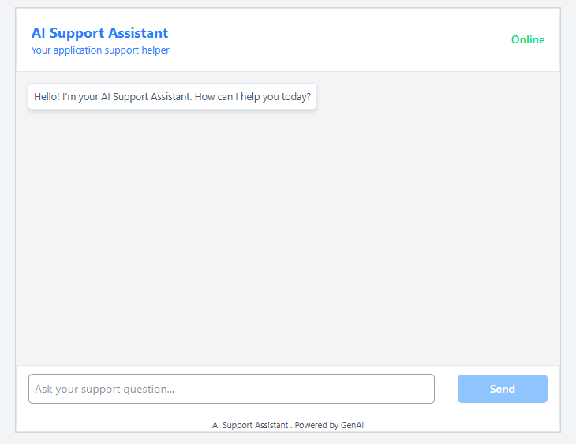
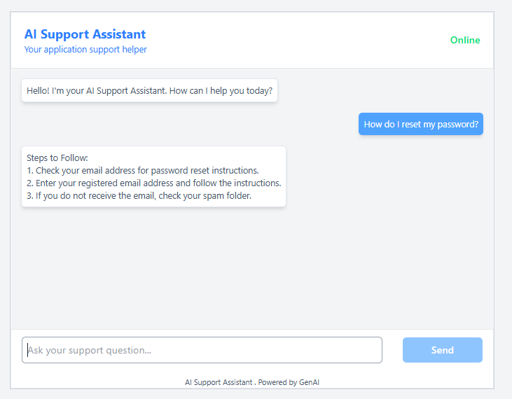
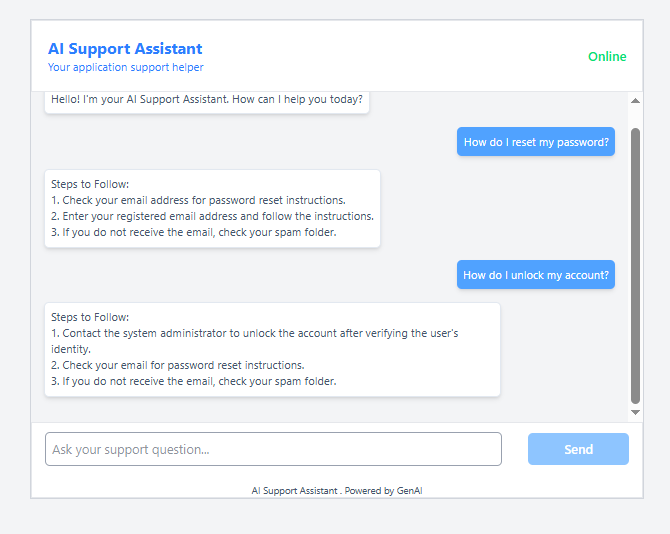

# AI Support Assistant

An AI-powered application support assistant built using React, FastAPI, Retrieval-Augmented Generation (RAG), ChromaDB, and Ollama.

The application allows users to ask questions about common application issues and receive answers based on relevant support documentation.

## Key Features

- Interactive chat interface built with React and Tailwind CSS.
- FastAPI backend for handling chat requests.
- Retrieval-Augmented Generation (RAG) for retrieving relevant support documents.
- ChromaDB as the vector database.
- Ollama for running a local Large Language Model (LLM).
- Error handling for unavailable backend and AI services.

## Application Screenshots

### Chat Interface

### Password Reset Response

### Multiple Conversations

## Application Architecture

The application follows a React frontend and FastAPI backend architecture.

### Request Flow

1. The user enters a question in the React chat interface.
2. React sends the question to the FastAPI `/chat` endpoint.
3. FastAPI passes the question to the RAG pipeline.
4. ChromaDB retrieves relevant support documents based on semantic similarity.
5. The retrieved documents are provided as context to the Ollama LLM.
6. Ollama generates an answer using the supplied context.
7. FastAPI returns the answer to React.
8. React displays the response in the chat interface.

### Technology Stack

| Layer             | Technology                      |
|-------------------|---------------------------------|
| Frontend          | React, JavaScript, Tailwind CSS |
| Backend           | Python, FastAPI                 |
| AI Integration    | Ollama                          |
| Language Model    | Llama 3.2 (1B)                  |
| RAG               | Retrieval-Augmented Generation  |
| Vector Database   | ChromaDB                        |
| API Communication | HTTP / REST                     |

## Installation and Setup

### Prerequisites
Install the following tools before running the application:

- Python 3.10+
- Node.js and npm
- Ollama
- Git

### 1. Clone the Repository
git clone <your-github-repository-url>
cd ai-support-assistant

### 2. Set Up the Backend

Create and activate a virtual environment:
python -m venv .venv

Windows:
.venv\Scripts\activate

Install Python dependencies:
pip install -r requirements.txt

### 3. Set Up Ollama

Download and install Ollama.

Pull the required model:
ollama pull llama3.2:1b

Make sure Ollama is running before sending chat requests.

### 4. Start the Backend

From the project root, run:
uvicorn main:app --reload

Backend URL:
http://localhost:8000

API documentation:
http://localhost:8000/docs

### 5. Set Up the Frontend
Open another terminal:
cd frontend
npm install

Create a `.env` file inside the `frontend` directory:
VITE_API_URL=http://localhost:8000

Start the React development server:
npm run dev

Frontend URL:
http://localhost:5173

Open the frontend URL in your browser to use the AI Support Assistant.
NOTE: Keep Ollama running while using the application. It runs locally and is not hosted by FastAPI.

## Current Limitations

- The application uses a small local language model (Llama 3.2 1B), so response quality may vary.
- The knowledge base currently contains sample application support documents.
- The application requires Ollama to be installed and running locally.
- User authentication and chat history persistence are not currently implemented.
- The application is intended as a learning and portfolio project, not a production support system.

## Future Improvements

- Improve document retrieval accuracy and evaluate retrieval quality.
- Add user authentication and role-based access.
- Store chat history for individual users.
- Support uploading additional knowledge base documents.
- Improve error handling and application logging.
- Explore stronger language models for better response quality.
- Add automated backend and frontend tests.
- Deploy the application with a suitable hosted AI inference service.